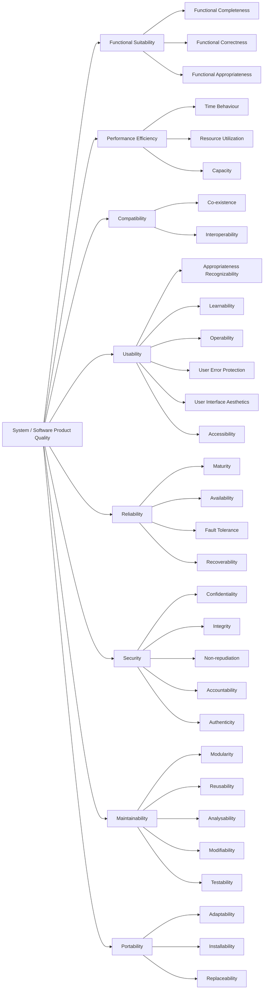

[](https://github.com/seahal/umaxica-apps-cosmos-governance/actions/workflows/ci.yml)


# Umaxica Apps Cosmos Governance

## Routing

- `base.app`, `base.com`, and `base.org`: Base-owned browser RP, identity, preference, and public
  surfaces. The anonymous `base.com` surface is intentionally retained.
- `tech.org`: the separate global operator browser RP.
- `mission`, `flipper`, `blazer`, `pghero`, `swagger`, and `coverband`: Governance's
  host-constrained operator tools.
- Governance does not serve the Visa OpenID Provider or credential ceremonies. Base App exposes a
  neutral RP entry, OIDC callback, RP-local sign-out, and Back-Channel Logout receiver. The
  authorization request leaves through Jump. Base App and Base Org receive a short-lived PS256 ID
  Token through the front channel, validate the signed browser state before reading Visa's JWKS,
  consume each token JTI once, and install only their own `sid`-bound RP session. The callback
  removes the token with a 303 redirect and sets no Access or Refresh Token cookie. Renewal passes
  through Visa with `prompt=none`; Governance issues a separate short-lived token from the active RP
  session for its own Base APIs. Base Org has its own client, Visa issuer, and RP cell. Access must
  complete the owner-approved ID Token response for both clients, and Jump's deployed trust path
  remains an external readiness condition; missing Visa host configuration fails closed. Tech OIDC
  browser sign-in remains disconnected.
- Other former product surfaces are not served here. Their route files and controllers have been
  removed; the retained database/model inventory is documented in the hard-reset evidence.

This multi-domain Rails application serves its owned surfaces. Routing is host-constrained, so the
domain and subdomain matter in both development and production.

Base and Tech remain separate route and authorization boundaries. Base App has `GET /sign`,
CSRF-protected `POST /sign`, `GET /sign/interruption`, and `GET /oidc/callback` for its
relying-party entry. Base Org exposes the same route shape on its own host and uses the
`base-org-ww` client, Visa staff issuer and `rp_base_org` cell. The callback accepts only the
owner-approved exact ID Token claim set, enforces the two-minute lifetime and Jump's 2,048
UTF-16-unit callback URL bound, and returns `Cache-Control: no-store` and
`Referrer-Policy: no-referrer`. Base API bearer tokens are Governance-signed, realm and audience
bound, and limited to five minutes; each receiver reloads the referenced RP session from its writer.
For both realms, signed-in users can confirm sign-out at `/sign/out/edit`; `POST /sign/out` commits
only the local RP session revocation before clearing local credentials and handing a no-hint Visa
request to Jump. `/sign/out/completion` accepts the matching one-time return, and
`POST /oidc/closures` commits verified Visa logout events in the local RP cell before acknowledging
them. Governance has no local Visa provider or credential ceremonies. Access authorization
availability and Jump's deployed trust path remain external readiness conditions; OIDC-driven
step-up callback routes remain absent. Tech RP entry, sign-out, and Back-Channel Logout remain
absent.

## Stack

### Backend

- Ruby on Rails (`8.2.x`, pre-release)
- Podman services for local infrastructure
- Storage: PostgreSQL (with Solid Queue), Valkey/Redis

### Frontend

- Two coexisting frontend approaches: Inertia Rails (React) and Rails' own default Vite Rails +
  Stimulus + Turbo stack
- Tailwind CSS via Vite, Propshaft for static assets
- Vite and Bun for JavaScript build, linting, formatting, and tests

### Infrastructure

- Dev: FakeCloud
- Test: N/A
- Prod: N/A
- CI: GitHub Actions
- CD: N/A

## Frontend and Assets

UI implementation should treat the Digital Agency of Japan Design System introduction as reading
before inventing screen patterns. Start at
[the introduction](https://design.digital.go.jp/dads/introduction/) and
`docs/reference/digital-agency-design-system.md`. This application's primitives remain in
`src/components/ui/` and `docs/design.md`.

- JavaScript entrypoints are bundled through Vite Rails from `src/entrypoints`.
- Stimulus controllers live in `src/controllers`.
- JavaScript tests live in `gait/` and run directly with Vitest.
- Browser CSS is one Vite stylesheet per surface under `src/styles/surfaces/`; each imports the
  shared token and base layers (`src/styles/theme.css`, `src/styles/base.css`).
- Static non-browser assets are served by Propshaft.

Useful commands:

```bash
bin/dev                         # Web, Vite, and jobs
bin/rails assets:precompile     # Production asset build
bin/rails vite:build            # Vite frontend build
bin/rails assets:clobber        # Remove compiled assets
```

## Local Setup

- Docker Compose, or rootless Podman with `podman-compose`
- Ruby `4.0.x`
- Bundler
- Node.js `26.13.1` (pinned in `.node-version`; `package.json` accepts `>=26.13.1 <27`)
- Bun `1.4.0`

### Credentials and secrets

`config/credentials/development.key`, `config/credentials/test.key`, and the repository-root `.env`
are not tracked in git. Obtain the two key files from the development lead; without them the
application cannot boot and `bin/rails test` cannot run. Credentials for AWS, Cloudflare, Fastly,
and other providers — staging, production, or an individual environment — are also requested from
the development lead and are never committed.

See `docs/operations/development-credential-provisioning.md` for the full procedure. For the
complete portable configuration contract, see `docs/operations/global-portability.md`.
`.env.container.devcontainer` contains the non-secret local defaults that
`.devcontainer/compose.yaml` loads into `core`. Every process, whatever its runtime role, reads the
Rails-standard `config/credentials/<env>.yml.enc`; there are no per-role credential bundles.

### The Bun toolchain

The development image provides the pinned Bun runtime declared by `package.json#packageManager`. Do
not install a second JavaScript package manager inside the container — a second copy on `PATH` makes
which tool ran depend on shell state.

`package.json#packageManager` declares the Bun version expected by the project and CI. Keep that pin
aligned with the Bun toolchain copied into the development and asset images. Corepack is not used,
and no `corepack enable` step is required.

A fresh clone needs no local file. Start the standard stack, install dependencies, and boot the app:

```bash
git clone https://github.com/seahal/umaxica-apps-cosmos-governance.git
cd umaxica-apps-cosmos-governance

# creating a local override is NOT required
docker compose config     # resolves as-is

docker compose up
bundle install
bun install --frozen-lockfile
bin/setup
```

`compose.yaml` owns shared infrastructure. Rails runs only in the Dev Container:
`.devcontainer/compose.yaml` adds `core`, and the same three commands above are run by hand inside
`core` — `devcontainer.json` declares no `postCreateCommand`, so creating the container neither
fetches dependencies nor touches a database. Running Rails directly on the host is not supported.
`compose.override.yaml` is the only other root Compose file. It is **untracked and gitignored**
(since 2026-09-14), auto-discovered by a bare `podman compose`, and everything in it is
profile-gated: it carries the opt-in `remote-access` Tailscale/sshd overlay of `core` and is where
per-machine settings go. Being untracked is what keeps those settings per-machine; a fresh clone
does not have the file, and does not need it. See the Dev Container startup documentation.

`config/database.yml` fixes the development and test connections to the Compose services: writers
and test databases on `primary`, development replicas on `replica`, port `5432`, user `root`,
password `development`. These are non-secret local values and are not read from the environment.
Production connections still come from the `NEON_*` variables.

WebAuthn uses one RP ID and one exact origin per surface (`app` and `org`). Production requires them
as environment variables; other environments read the same variables first and fall back to the
encrypted credentials `webauthn.<surface>.rp_id` / `origin`. A missing value raises. The RP ID must
equal the origin host (`app/values/webauthn/relying_party_config.rb`).

```bash
WEBAUTHN_APP_RP_ID  WEBAUTHN_APP_ORIGIN
WEBAUTHN_ORG_RP_ID  WEBAUTHN_ORG_ORIGIN
```

`bin/setup` installs Ruby gems, runs `bun install --frozen-lockfile` and `bin/rails db:prepare`,
clears logs and temp files, then starts `bin/dev` (pass `--skip-server` to stop before that).

If dependencies are already installed, you can start development directly:

```bash
bin/dev
```

`bin/dev` is the unified local entrypoint. It runs `bin/rails db:prepare` unless
`SKIP_DB_PREPARE=1`, then starts:

- `web`: Rails server on port `3000`
- `vite`: `bin/vite dev`
- `jobs`: `bin/jobs start`

## Development URLs

Modern browsers resolve `*.localhost` to `127.0.0.1`, so extra `/etc/hosts` entries are usually not
needed.

The URLs below use port `3000`, where host-native Rails listens. The Dev Container publishes its
Rails port `3000` on host port `3001` and Vite on `3036`, both on `127.0.0.1` only, so from the host
a Dev Container is reached on `:3001`. Substituting the host's LAN or Tailscale address will not
connect, by design. `compose.yaml` publishes the PostgreSQL writer and reader and the Valkey
services to loopback as well (`5432`, `5433`, and `6379` to `6381` by default) so host-native Rails
can use them; containers continue to use Compose DNS names. See
`docs/operations/development-host-port-exposure.md`.

| Surface                 | URL                                                                                    |
| :---------------------- | :------------------------------------------------------------------------------------- |
| Base                    | `http://base.{app,com,org}.localhost:3000`                                             |
| Tech                    | `http://tech.org.localhost:3000`                                                       |
| Operator tools          | `http://{mission,flipper,blazer,pghero,swagger,coverband}-governance.umaxica.dev:3000` |
| Operator tools (public) | `https://<tool>-governance.umaxica.dev`                                                |

The application contract supplies PUBLIC and PRIVATE URL values in both supported modes; Compose
supplies only service topology. Each route host constraint lists the configured host alongside its
localhost literal. Development is published through Cloudflare Tunnel behind Cloudflare Access;
Access, not Host Authorization, keeps the development listener non-public. See
`docs/architecture/cloudflare-request-paths.md` for the trust boundaries and
`research/implementation/2026-08-10-development-tunnel-access-verification.md` for the measured
end-to-end evidence.

Base and Tech verification, identity and authenticated-session routes remain. Base App has the RP
entry, callback, sign-out and Back-Channel Logout endpoints described above; they depend on the
explicit Visa host contract and Access completing its owner-approved ID Token response. Base Org has
the same local RP entry, callback, sign-out and Back-Channel Logout shape in its separate RP cell.
Jump's deployed trust path and real-provider callback size remain external verification items. Tech
browser sign-in remains disconnected and has no local RP sign-out or Back-Channel Logout endpoint;
its server-to-server capability check uses a short-lived Governance token from its existing local RP
session.

## Code Quality

This project organizes code quality around the ISO/IEC 25010 System / Software Product Quality
model. The `Linting and Formatting` / `Testing` / `Security and Quality Checks` sections below each
correspond to concrete, operational means of supporting these quality characteristics.



## Linting and Formatting

```bash
bundle exec rubocop
bundle exec rubocop -a
bundle exec erb_lint .
bundle exec erb_lint -a .
bun run check
bun run fix
```

Use `rubocop -a`, `erb_lint -a .`, and `bun run fix` to apply auto-fixes where available.

## Testing

### Rails Tests

```bash
bundle exec rails test
COVERAGE=true bundle exec rails test test/
```

Rails generates a Valkey test-run namespace when one is not supplied. Coverage reports are written
to `coverage/`. Set `PARALLEL_WORKERS=1` for a focused run when diagnosing a failure.

### JavaScript Tests

Run JavaScript tests with Vitest:

```bash
bun run test
bun run test:watch                            # Watch mode
bun run test:coverage
```

JavaScript tests are located in `gait/` and use Vitest. Coverage reports are written under
`coverage/vite/`.

## Security and Quality Checks

```bash
bundle exec brakeman --no-pager
bundle exec bundler-audit check --update
bun audit
bundle exec debride
```

`debride` is configured for Rails-aware analysis and can also be scoped to specific paths:

```bash
bundle exec debride app/services
DEBRIDE_MINIMUM=5 bundle exec debride
```

## Logging

Application logging is structured. Prefer event-style logging over ad hoc `Rails.logger` calls when
adding domain events or operational signals.

```ruby
Rails.event.notify("user.created", user_id: user.id)
Rails.event.tagged("auth") { Rails.event.notify("login.success", user_id: user.id) }
```

## Pre-commit Checks

Run the Lefthook pre-commit checks before committing:

```bash
lefthook run pre-commit
```

The pre-commit hook formats staged files with oxfmt, autocorrects them with oxlint and RuboCop, and
compiles every ERB template when a view changed. The pre-push hook runs `bun run ci` (JavaScript
checks, Vitest with coverage, and the production build). Security audits and the full Rails suite
run in CI, not in the hooks.

## Troubleshooting

| Problem                                  | Fix                                                                          |
| :--------------------------------------- | :--------------------------------------------------------------------------- |
| Tailwind changes are not reflected       | Run `bin/rails assets:clobber` and restart `bin/dev`                         |
| Tests fail because databases are missing | Run `bin/rails db:prepare`                                                   |
| `bin/dev` stops during boot              | Check Base and Tech surface URL configuration and database availability      |
| Credentials cannot be decrypted          | Obtain the key; see `docs/operations/development-credential-provisioning.md` |

## Repository Knowledge Base

See [repository knowledge architecture](docs/reference/repository-knowledge-architecture.md) for
ownership, authority and lifecycle.

- [Specs](specs/README.md): accepted change contracts.
- [ADRs](adr/repository-knowledge-and-agent-harness.md): accepted decisions and their rationale.
- [Docs](docs/index.md): current engineering documentation and durable acceptance checklists.
- [Research](research/README.md): non-authoritative institutional memory and rejected approaches.
- [Plans](plans/README.md): unaccepted proposals and useful planning history.
- `evidence/`: actual observations against a stated revision, not expectations.
- [Manuals](manuals/README.md): user guidance; presence does not mean published.
- `test/`, `gait/`, `e2e/`: Minitest, Vitest and Playwright respectively.

## Acknowledgement

- Secrets must stay in Rails credentials; do not commit plaintext secrets.
- WebAuthn RP IDs and exact origins are configured per retained surface; `TRUSTED_ORIGINS` is
  additive only.
- Public availability of this repository is not guaranteed permanently.
